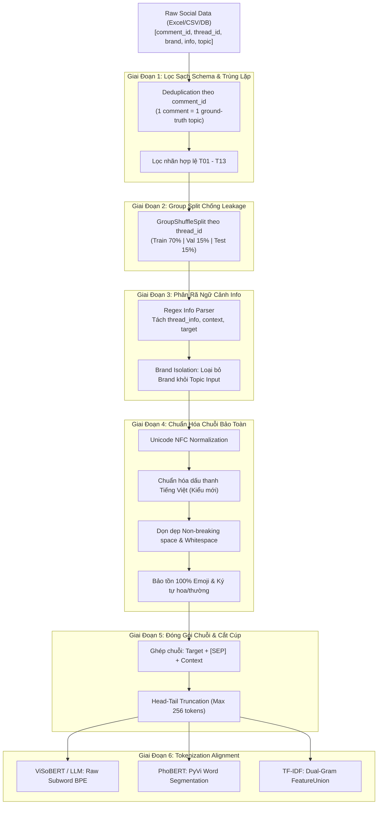

# CHUYÊN KHẢO KỸ THUẬT: PIPELINE TIỀN XỬ LÝ DỮ LIỆU CHUYÊN SÂU
## Deep-Dive Data Preprocessing Pipeline for Vietnamese Social Listening
**Dự án:** Vietnamese Social Listening NLP Engine  
**Chuyên đề:** End-to-End Data Engineering & Text Preprocessing for Topic Classification (13 Classes)  
**Tác giả:** Đội ngũ Nghiên cứu & Kỹ thuật NLP  
**Ngày cập nhật:** 09/11/2026  

---

## MỤC LỤC
1. [Kiến Trúc Tổng Thể Data Pipeline](#1-kiến-trúc-tổng-thể-data-pipeline)
2. [Chuẩn Hóa Ký Tự & Ngữ Pháp Tiếng Việt Học (Orthography & Encoding)](#2-chuẩn-hóa-ký-tự--ngữ-pháp-tiếng-việt-học)
3. [Chiến Lược Tiền Xử Lý Bảo Toàn (Conservative Preprocessing In-Depth)](#3-chiến-lược-tiền-xử-lý-bảo-toàn-conservative-preprocessing-in-depth)
4. [Thuật Toán Bóc Tách Trường Info & Truncation Strategy](#4-thuật-toán-bóc-tách-trường-info--truncation-strategy)
5. [Cơ Chế Khử Trùng Lặp & Chống Rò Rỉ Dữ Liệu Bằng GroupKFold](#5-cơ-chế-khử-trùng-lặp--chống-rò-rỉ-dữ-liệu-bằng-groupkfold)
6. [Ma Trận Khớp Nối Tokenization Theo Từng Họ Mô Hình](#6-ma-trận-khớp-nối-tokenization-theo-từng-họ-mô-hình)

---

## 1. KIẾN TRÚC TỔNG THỂ DATA PIPELINE

Pipeline dữ liệu được thiết kế theo nguyên lý **bảo toàn tối đa tín hiệu ngữ nghĩa (Maximum Information Preservation)**, chia thành 6 giai đoạn tuần tự từ dữ liệu cào thô (Raw Scraped Data) đến Tensor đầu vào cho mô hình:



---

## 2. CHUẨN HÓA KÝ TỰ & NGỮ PHÁP TIẾNG VIỆT HỌC

### 2.1. Giải quyết xung đột Unicode NFC vs. NFD (Tổ hợp vs. Dựng sẵn)
* **Vấn đề thực tế:** Người dùng mạng xã hội tại Việt Nam sử dụng nhiều bộ gõ khác nhau (Unikey, EVKey, OpenKey, bàn phím mặc định iOS/Android).
  * Bộ gõ chuẩn cũ hoặc lỗi tạo ra **Unicode NFD (Decomposed / Dựng tổ hợp)**: Ký tự nguyên âm và dấu thanh bị tách thành 2 mã hex độc lập (ví dụ chữ `ế` bị tách thành `e` + dấu nón `^` + dấu sắc `/`).
  * Bộ gõ chuẩn mới tạo ra **Unicode NFC (Precomposed / Dựng sẵn)**: Toàn bộ chữ `ế` là một mã hex duy nhất (`\u1ebf`).
* **Hậu quả nếu không chuẩn hóa:** Tokenizer của mô hình (ViSoBERT, PhoBERT) sẽ nhìn chữ `ế` tổ hợp như hai ký tự xa lạ, dẫn tới việc tách vỡ thành các token vụn và sinh ra mã OOV (Out-Of-Vocabulary) giả tạo.
* **Quy chuẩn kỹ thuật:** Mọi chuỗi ký tự bắt buộc chạy qua:
  ```python
  import unicodedata
  text = unicodedata.normalize("NFC", text)
  ```

### 2.2. Chuẩn hóa vị trí dấu thanh tiếng Việt (Dấu kiểu mới vs. Dấu kiểu cũ)
Trong chính tả tiếng Việt có hai trường phái đặt dấu thanh trên các nguyên âm đôi/ba (`oa`, `oe`, `uy`):
1. **Kiểu cũ (Hòa bình, thủy điện, khỏe khoắn):** Đặt dấu ở nguyên âm đầu (`hoà`, `thuỷ`, `khoẻ`).
2. **Kiểu mới (Chuẩn Bộ GD&ĐT):** Đặt dấu ở nguyên âm chính âm tiết (`hòa`, `thủy`, `khỏe`).
* Sự không đồng nhất này khiến mô hình coi `hoà` và `hòa` là hai từ vựng khác nhau.
* **Giải thuật chuẩn hóa tự động:** Hệ thống tích hợp từ điển quy chuẩn vị trí dấu thanh:
  ```python
  VIETNAMESE_ACCENT_MAP = {
      "hoà": "hòa", "toà": "tòa", "loà": "lòa", "choà": "chòa",
      "thuỷ": "thủy", "tuỷ": "tủy", "huỷ": "hủy", "luỷ": "lũy",
      "khoẻ": "khỏe", "loè": "lòe", "toè": "tòe",
      "quảnh": "quảnh", "quán": "quán", "quản": "quản"
  }
  ```

### 2.3. Xử lý các ký tự điều khiển và khoảng trắng phi chuẩn
Mạng xã hội cào về chứa hàng loạt ký tự rác ẩn:
* `\u00a0`: Non-breaking space (phổ biến khi người dùng copy-paste từ web/Word).
* `\u200b`: Zero-width space (ký tự rỗng vô hình gây phình độ dài chuỗi).
* `\ufeff`: Byte Order Mark (BOM).
* **Regex Engine dọn dẹp chuẩn xác:**
  ```python
  def sanitize_whitespace(text: str) -> str:
      text = text.replace("\u00a0", " ").replace("\u200b", "").replace("\ufeff", "")
      # Gộp các khoảng trắng liên tiếp nhưng không phá hủy cấu trúc dòng nếu cần
      text = re.sub(r"[^\S\r\n]+", " ", text)
      return text.strip()
  ```

---

## 3. CHIẾN LƯỢC TIỀN XỬ LÝ BẢO TOÀN (CONSERVATIVE PREPROCESSING IN-DEPTH)

Khác với các bộ xử lý dữ liệu truyền thống thường "dọn sạch quá mức" (Destructive Cleaning), quy trình của chúng tôi áp dụng 4 nguyên tắc bảo toàn nghiêm ngặt:

### 3.1. Bảo tồn 100% Emoji (Emoji Preservation Framework)
* **Cơ sở khoa học:** Nghiên cứu *ViGoEmotions (EACL 2026)* và *ViSoBERT (EMNLP 2023)* chứng minh: Trên mạng xã hội tiếng Việt, Emoji là vật mang **tín hiệu ngữ nghĩa và cảm xúc mật độ cao nhất**.
* **Đặc thù trong bài toán Topic:**
  * Khách hàng dùng ⚡, 🔋, 🔌 để nói về sạc/pin $\rightarrow$ Định hướng thẳng về **T01** hoặc **T02**.
  * Khách hàng dùng 🛠️, 🔧, 🚗 để nói về xưởng sửa chữa $\rightarrow$ Định hướng về **T05** hoặc **T06**.
  * Khách hàng dùng 😡, 🤬, 🤮, 👎 biểu thị sự bức xúc về thái độ hoặc dịch vụ.
* **Chiến lược:** 
  * Không dùng regex để xóa emoji.
  * Không dịch emoji thành chữ tiếng Anh (như `:angry_face:`) vì làm tăng độ dài câu và lệch phân phối từ vựng tiếng Việt.
  * ViSoBERT đã được pretrain trên hàng triệu bình luận chứa emoji, không gian nhúng của nó đã tự học được vector ngữ nghĩa tương ứng của từng emoji.

### 3.2. Bảo tồn chữ hoa/chữ thường (Cased Representation)
* **Tại sao không dùng `lower()`?**
  1. **Thực thể thương hiệu và dòng xe:** `VinFast`, `VF8`, `VF3`, `BYD`, `Toyota`, `Porsche` nếu bị hạ chữ thường thành `vf8`, `vf3` sẽ làm suy yếu khả năng nhận diện Named Entity của mô hình.
  2. **Từ viết tắt kỹ thuật ngành:** `XDV` (Xưởng dịch vụ), `CSKH` (Chăm sóc khách hàng), `PIN`, `LFP`, `BMS`, `SOC` (State of Charge).
  3. **Ngữ khí nhấn mạnh:** Chữ viết hoa cả từ (`QUÁ TỆ`, `LỪA ĐẢO`, `ĐẮT CẮT CỔ`) là chỉ báo quan trọng giúp phân biệt giữa một câu nhận xét bình thường và một khiếu nại gay gắt.

### 3.3. Dấu câu tự nhiên (Punctuation Normalization)
* Giữ nguyên dấu `!`, `?`, `?!`, `...`.
* **Quy chuẩn dọn dẹp dấu câu lặp:** Người dùng mạng xã hội thường gõ: `kinh khủng quá!!!!!!!!` hoặc `thế này mà cũng coi là dịch vụ à??????`.
  * Chuẩn hóa: Gom các dấu lặp liên tiếp $\ge 3$ lần về tối đa **2 dấu** để giữ ngữ khí mà không làm loãng độ dài chuỗi:
  ```python
  text = re.sub(r"(!)\1+", "!!", text)
  text = re.sub(r"(\?)\1+", "??", text)
  text = re.sub(r"(\.)\1+", "...", text)
  ```

### 3.4. Từ kéo dài (Elongated Words Behavior)
* Các từ cảm thán kéo dài: `quáaaa`, `tệ ghêeee`, `đẹpppp`.
* **Cảnh báo sai lầm:** Một số hệ thống dùng regex `([a-z]+)\1+ -> \1` để co từ. Điều này gây thảm họa:
  * `Facebook` $\rightarrow$ `Facebok`
  * `boong tàu` $\rightarrow$ `bong tàu`
  * `buffet` $\rightarrow$ `bufet`
  * Các từ có 2 nguyên âm tiếng Việt (`xoong`, `quần soóc`) bị phá hủy hoàn toàn.
* **Giải pháp của dự án:** Để cho bộ tách từ Subword (Byte-level BPE của ViSoBERT) tự xử lý. BPE sẽ tách `quáaaa` thành `['quá', 'aa', 'a']`. Mô hình hoàn toàn học được rằng các token đuôi `aa` là biểu thị sự nhấn mạnh cường điệu.

---

## 4. THUẬT TOÁN BÓC TÁCH TRƯỜNG INFO & TRUNCATION STRATEGY

Dữ liệu Social Listening thô thường được gom vào một trường văn bản hỗn hợp `info`. Chúng tôi xây dựng bộ bóc tách chuyên sâu **Regex Multi-Pattern Engine**.

### 4.1. Thuật toán phân rã 3 trường thông tin
```python
import re
from typing import Dict

def robust_info_parser(info_str: str) -> Dict[str, str]:
    if not isinstance(info_str, str) or not info_str.strip():
        return {"thread_info": "", "context": "", "target": ""}

    text = info_str.strip()
    thread_info, context, target = "", "", ""

    # Pattern chính quy nhận diện linh hoạt viết hoa/thường và khoảng trắng
    pattern = re.compile(
        r"^(?:thread_info:\s*(?P<thread>.*?))?"
        r"(?:context:\s*(?P<context>.*?))?"
        r"target:\s*(?P<target>.*)$",
        re.IGNORECASE | re.DOTALL
    )
    match = pattern.match(text)
    if match:
        thread_info = match.group("thread") or ""
        context = match.group("context") or ""
        target = match.group("target") or ""
    else:
        # Trường hợp dữ liệu không có nhãn prefix, toàn bộ câu là Target
        target = text

    # Lọc chỉ thị rỗng
    def clean_val(v: str) -> str:
        v_clean = v.strip()
        if v_clean.lower() in {"(không có)", "không có", "none", "nan", "null", "n/a", ""}:
            return ""
        return v_clean

    return {
        "thread_info": clean_val(thread_info),
        "context": clean_val(context),
        "target": clean_val(target)
    }
```

### 4.2. Nguyên tắc Cách Ly Thương Hiệu (Brand Isolation)
* **Ràng buộc thép:** Trong bài toán Topic Classification, trường `brand` **TUYỆT ĐỐI KHÔNG ĐƯỢC PHÉP** xuất hiện trong chuỗi input của mô hình.
* Chuỗi hoàn chỉnh đưa vào model:
  $$\text{Input}_{\text{Topic}} = \begin{cases} 
  \text{"Target: } \{target\} \text{ [SEP] Context: } \{context\}\text{"} & \text{nếu Context} \neq \emptyset \\
  \text{"Target: } \{target\}\text{"} & \text{nếu Context} = \emptyset
  \end{cases}$$

### 4.3. Chiến lược Cắt Cúp Chuỗi Bảo Toàn (Head-Tail Truncation Strategy)
Khi độ dài token vượt quá giới hạn $L_{\max} = 256$ tokens:
* **Nguyên tắc bất biến:** `Target` là nội dung chính, **BẮT BUỘC giữ nguyên 100% token của Target**.
* Nếu tổng số token vượt $256$, chỉ được phép cắt ngắn trường `Context`.
* Kỹ thuật **Left-Truncation trên Context**: Cắt bớt phần đầu của Context, chỉ giữ lại phần đuôi của Context (vì phần đuôi là câu nói tiếp giáp gần nhất với Target, mang ngữ cảnh chuyển tiếp cao nhất):

```text
[CONTEXT CỰC DÀI (Bị cắt bỏ phần đầu)] ... [Đuôi Context] [SEP] [TOÀN BỘ TARGET ĐƯỢC GIỮ NGUYÊN]
```

---

## 5. CƠ CHẾ KHỬ TRÙNG LẶP & CHỐNG RÒ RỈ DỮ LIỆU BẰNG GROUPKFOLD

### 5.1. Bổ đề Khử Trùng Lặp Topic (Topic Deduplication Lemma)
* Trong dữ liệu Social Listening:
  * Một bình luận nhắc tới 3 thương hiệu (`VinFast`, `Toyota`, `Hyundai`) sẽ sinh ra 3 dòng trong bảng dữ liệu để chấm Sentiment cho từng hãng.
  * **Nhưng về mặt bản chất nghiệp vụ, bình luận đó chỉ phản ánh ĐÚNG MỘT chủ đề nòng cốt chi phối.**
* **Quy tắc bắt buộc:** Khi huấn luyện mô hình Topic, bắt buộc phải gom nhóm theo `comment_id` và khử trùng lặp (`df.drop_duplicates(subset=['comment_id'])`). 
* Nếu không deduplicate, các bình luận nhắc nhiều hãng xe sẽ bị nhân bản số lượng lên gấp $2 \sim 4$ lần, làm sai lệch hoàn toàn hàm mất mát và phân phối xác suất tiên nghiệm $P(Y)$ của 13 lớp.

### 5.2. Chống Rò Rỉ Luồng Thảo Luận Bằng GroupKFold
* **Nguy cơ rò rỉ (Thread Leakage):** Trên mạng xã hội, các bình luận trong cùng một bài đăng (`thread_id`) sử dụng chung tập từ vựng, cùng bàn luận về một sự việc cụ thể (ví dụ: một vụ tai nạn xe, một chương trình khuyến mãi trạm sạc).
* Nếu chia ngẫu nhiên (Random Split), các bình luận của cùng một bài đăng sẽ nằm ở cả tập Train và tập Test. Mô hình sẽ đạt điểm Test cao giả tạo vì đã "học thuộc" bối cảnh của bài đăng đó.
* **Giải pháp chuẩn mực:** Phân chia tập dữ liệu theo nhóm bằng `GroupShuffleSplit` hoặc `GroupKFold` dựa trên khóa `thread_id`:
  $$\text{Thread}(i) \cap \text{Thread}(j) = \emptyset \quad \forall i \in \text{Train}, j \in \text{Test}$$

---

## 6. MA TRẬN KHỚP NỐI TOKENIZATION THEO TỪNG HỌ MÔ HÌNH

Không có một phương pháp tiền xử lý nào phù hợp cho mọi mô hình. Hệ thống phân chia thành 3 luồng xử lý độc lập:

| Kiến trúc mô hình | Cơ chế Tokenizer | Yêu cầu phân đoạn từ (Word Segmentation) | Định dạng chuỗi cuối cùng |
|---|---|---|---|
| **ViSoBERT / XLM-R** | Byte-level BPE (Byte-Pair Encoding) | **KHÔNG DÙNG TÁCH TỪ**. Giữ nguyên raw text tự nhiên. | `Target: ... [SEP] Context: ...` |
| **PhoBERT-base-v2** | FastBPE trên VnCoreNLP Dictionary | **BẮT BUỘC DÙNG `pyvi`**. Nối từ ghép bằng dấu gạch dưới `_`. | `Target: trạm_sạc ... [SEP] Context: ...` |
| **TF-IDF Baseline** | Scikit-learn Regex Tokenizer | **FeatureUnion song song:**<br>• Word n-grams $(1, 2)$<br>• Char-wb n-grams $(3, 5)$ | `Target: ... [SEP] Context: ...` (Raw text) |
| **Decoder LLM (Qwen3.5)** | TikToken / HuggingFace FastTokenizer | **KHÔNG DÙNG TÁCH TỪ**. ChatML format có System Prompt. | `<im_start>system...<im_start>user...` |
