# NGHIÊN CỨU CHUYÊN SÂU: ĐẶC TẢ 13 CHỦ ĐỀ & MA TRẬN RANH GIỚI NGỮ NGHĨA
## Deep-Dive Taxonomy & Semantic Boundary Analysis for Vietnamese Social Listening
**Dự án:** Vietnamese Social Listening NLP Engine  
**Chuyên đề:** Single-Label Topic Classification (T01 – T13)  
**Ngày cập nhật:** 09/11/2026  

---

## 1. TỔNG QUAN BÀI TOÁN & THÁCH THỨC ĐẶC THÙ

Trong hệ sinh thái Social Listening ngành ô tô và xe điện tại Việt Nam, bài toán **Single-label Topic Classification** đòi hỏi hệ thống phải xác định chính xác **một mối quan tâm nòng cốt duy nhất (dominant concern)** từ hàng triệu phản hồi của người dùng.

### 1.1. Bản chất kỹ thuật
* **Đơn vị phân loại:** Cấp độ bình luận (`comment_id`). Mọi bình luận phải được khử trùng lặp (deduplicated), không phụ thuộc vào số lượng thương hiệu được nhắc tới.
* **Không gian nhãn:** Tập hữu hạn 13 lớp rời rạc $\mathcal{C} = \{T01, T02, \dots, T13\}$.
* **Hàm mục tiêu:** Mô hình tối ưu hóa xác suất hậu nghiệm $P(y = c \mid \mathbf{x})$ thông qua hàm kích hoạt Softmax và hàm mất mát Cross Entropy:
  $$\hat{y} = \arg\max_{c \in \mathcal{C}} P(y = c \mid \mathbf{x})$$

### 1.2. Thách thức lớn nhất: Sự chồng lấn ngữ nghĩa (Semantic Overlap)
Khác với phân loại tin tức báo chí (nơi các chủ đề như *Thể thao*, *Chính trị*, *Khoa học* có từ vựng tách biệt rõ rệt), các chủ đề Social Listening dịch vụ ô tô có sự giao thoa từ ngữ rất lớn:
* Cùng một từ khóa *"tiền"*, *"đắt"*, *"phí"* có thể thuộc **T08** (giá phụ tùng), **T13** (giá sạc điện) hoặc **T03** (phí bảo hành).
* Cùng một từ khóa *"xe cứu hộ"*, *"hỏng giữa đường"* có thể thuộc **T09** (cứu hộ khẩn cấp) hoặc **T11** (xe sửa chữa lưu động Mobile Service).
* Khách hàng mạng xã hội thường có xu hướng gộp nhiều vấn đề vào một bình luận duy nhất (Multi-aspect expression), nhưng hệ thống lại yêu cầu xuất ra **duy nhất một nhãn chính**.

---

## 2. CẤU TRÚC PHÂN CẤP 13 CHỦ ĐỀ (HIERARCHICAL TAXONOMY)

Nhằm tối ưu hóa việc phân định ranh giới, 13 chủ đề được cấu trúc thành **4 nhóm chức năng nghiệp vụ (Macro-clusters)**:

```mermaid
graph TD
    Root["Hệ Thống 13 Chủ Đề Social Listening"]
    
    C1["Nhóm I: Hạ Tầng Sạc & Năng Lượng"]
    C2["Nhóm II: Hệ Thống Xưởng Dịch Vụ (XDV)"]
    C3["Nhóm III: Hậu Mãi & Hỗ Trợ Khách Hàng"]
    C4["Nhóm IV: Đề Cập Tổng Quan"]
    
    Root --> C1
    Root --> C2
    Root --> C3
    Root --> C4
    
    C1 --> T01["T01: Pin & Sạc chung"]
    C1 --> T02["T02: Hạ tầng Trạm Sạc / Đổi Pin"]
    C1 --> T13["T13: Chi phí & Chính sách sạc"]
    
    C2 --> T05["T05: Mạng lưới & Cơ sở XDV"]
    C2 --> T06["T06: Chất lượng kỹ thuật tại XDV"]
    C2 --> T07["T07: Thái độ & Chuyên môn nhân sự"]
    C2 --> T08["T08: Chi phí sửa chữa & Phụ tùng"]
    
    C3 --> T03["T03: Chính sách hậu mãi & Bảo hành"]
    C3 --> T04["T04: Quy trình đặt hẹn dịch vụ"]
    C3 --> T09["T09: Cứu hộ khẩn cấp 24/7"]
    C3 --> T10["T10: Tổng đài CSKH"]
    C3 --> T11["T11: Dịch vụ sửa chữa tại nhà"]
    
    C4 --> T12["T12: Đề cập chung"]
```



---

## 3. ĐẶC TẢ CHI TIẾT TỪNG CHỦ ĐỀ: IN-SCOPE, OUT-OF-SCOPE & KEYWORDS

### Nhóm I: Hạ Tầng Sạc & Năng Lượng

#### `T01: Pin & Sạc`
* **Định nghĩa:** Bàn luận về công nghệ pin, dung lượng, độ chai pin, tốc độ sạc kỹ thuật trên xe, trải nghiệm cắm sạc nói chung mà **không tập trung vào địa điểm trụ trạm cụ thể hoặc chi phí tiền bạc**.
* **In-scope (Bao hàm):** Dung lượng pin (kWh), tầm vận hành sau 1 lần sạc, pin LFP, pin ternary, thời gian sạc từ 10% đến 80%, lỗi phần mềm báo ảo pin trên xe.
* **Out-of-scope (Loại trừ):**
  * Nói về tình trạng trạm sạc bị chiếm chỗ, trạm sạc hỏng trụ $\rightarrow$ Chuyển về **T02**.
  * Phàn nàn về giá điện sạc, phí thuê pin hàng tháng $\rightarrow$ Chuyển về **T13**.
* **Keywords nhận diện:** `pin`, `dung lượng pin`, `chai pin`, `sạc chậm`, `sạc nhanh`, `quãng đường`, `lfp`, `soc`, `bms`, `nhiệt độ pin`.

#### `T02: Chất lượng hạ tầng Sạc / Đổi Pin`
* **Định nghĩa:** Mức độ sẵn sàng, mật độ phủ sóng, trải nghiệm thực tế tại trạm sạc, trụ sạc vật lý hoặc điểm đổi pin.
* **In-scope:** Trụ sạc hỏng, đứt súng sạc, trạm sạc bị xe xăng chiếm chỗ (ICE-ing), trạm sạc ở chung cư/trung tâm thương mại, bản đồ tìm trạm sạc, tốc độ triển khai trạm sạc mới.
* **Out-of-scope:**
  * Thắc mắc về biểu giá sạc, tiền phạt chiếm trụ sạc $\rightarrow$ Chuyển về **T13**.
  * Nhận xét chất lượng viên pin gắn trên xe $\rightarrow$ Chuyển về **T01**.
* **Keywords nhận diện:** `trạm sạc`, `trụ sạc`, `súng sạc`, `chiếm trụ`, `bãi sạc`, `cây sạc`, `hết chỗ sạc`, `điểm đổi pin`, `phủ sóng trạm`, `app trạm sạc`.

#### `T13: Chi phí & chính sách sạc`
* **Định nghĩa:** Mọi vấn đề liên quan đến tiền bạc, biểu giá, chi phí sử dụng dịch vụ sạc, thuê pin, đặt cọc pin và chính sách ưu đãi/miễn phí sạc.
* **In-scope:** Giá điện sạc/kWh, phí đỗ xe khi đang sạc, tiền phạt đỗ xe quá giờ sau khi sạc đầy, gói cước thuê pin cố định/linh hoạt, chính sách sạc pin miễn phí 1 năm, hóa đơn thanh toán sạc qua ứng dụng.
* **Out-of-scope:**
  * Chi phí thay thế phụ tùng cơ khí, bảo dưỡng định kỳ $\rightarrow$ Chuyển về **T08**.
* **Keywords nhận diện:** `giá sạc`, `phí sạc`, `thuê pin`, `cước pin`, `tiền điện`, `miễn phí sạc`, `phạt quá giờ`, `thanh toán sạc`, `hóa đơn sạc`, `tăng giá sạc`.

---

### Nhóm II: Hệ Thống Xưởng Dịch Vụ (XDV)

#### `T05: Hệ thống Xưởng Dịch vụ (XDV)`
* **Định nghĩa:** Đánh giá về mạng lưới, địa điểm phân bố, cơ sở vật chất, mặt bằng, trang thiết bị máy móc tại các xưởng dịch vụ.
* **In-scope:** Xưởng gần nhà/xa nhà, tỉnh lẻ chưa có xưởng phải đi tỉnh khác sửa, diện tích xưởng chật chội, phòng chờ khách hàng nóng bức/thiếu nước uống, trang thiết bị xưởng hiện đại.
* **Out-of-scope:**
  * Nhận xét tay nghề kỹ thuật viên sửa không hết lỗi $\rightarrow$ Chuyển về **T06**.
  * Phàn nàn nhân viên lễ tân xưởng khó chịu $\rightarrow$ Chuyển về **T07**.
* **Keywords nhận diện:** `xưởng dịch vụ`, `xdv`, `đại lý`, `cơ sở vật chất`, `phòng chờ`, `mặt bằng`, `gần nhà`, `mở thêm xưởng`, `trang thiết bị xưởng`.

#### `T06: Chất lượng dịch vụ tại XDV`
* **Định nghĩa:** Kết quả chuyên môn, năng lực sửa chữa, độ tin cậy kỹ thuật và thời gian hoàn thành công việc bảo hành/sửa chữa tại xưởng.
* **In-scope:** Xe vào xưởng nằm chờ nhiều ngày chưa sửa xong, sửa xong đi một tuần lại bị lỗi cũ, bắt đúng bệnh xe, quy trình kiểm tra xe cẩn thận, rửa xe sạch sẽ sau bảo dưỡng.
* **Out-of-scope:**
  * Thái độ giao tiếp, ánh mắt, lời ăn tiếng nói của thợ/cố vấn $\rightarrow$ Chuyển về **T07**.
  * Chê giá tiền công hoặc giá phụ tùng thay thế quá đắt $\rightarrow$ Chuyển về **T08**.
* **Keywords nhận diện:** `sửa xe`, `tay nghề`, `bắt bệnh`, `lỗi tái phát`, `nằm xưởng`, `bảo dưỡng định kỳ`, `xử lý triệt để`, `thời gian sửa`, `chất lượng sửa`.

#### `T07: Thái độ và chuyên môn của nhân sự XDV`
* **Định nghĩa:** Đánh giá về tác phong, thái độ phục vụ, mức độ nhiệt tình, sự trung thực và cách ứng xử của đội ngũ nhân viên xưởng (cố vấn dịch vụ, kỹ thuật viên, thu ngân, lễ tân).
* **In-scope:** Cố vấn dịch vụ niềm nở, tư vấn có tâm, kỹ thuật viên giải thích cặn kẽ cho khách, nhân viên gắt gỏng, coi thường khách hàng, thái độ lồi lõm, trốn tránh trách nhiệm.
* **Out-of-scope:**
  * Nhân viên tổng đài trực điện thoại hotline $\rightarrow$ Chuyển về **T10**.
* **Keywords nhận diện:** `thái độ`, `cố vấn dịch vụ`, `nhân viên xưởng`, `kỹ thuật viên`, `nhiệt tình`, `chu đáo`, `lồi lõm`, `khó chịu`, `chuyên môn kém`, `tư vấn tận tâm`.

#### `T08: Chi phí sửa chữa, bảo dưỡng, thay thế phụ tùng`
* **Định nghĩa:** Các vấn đề tài chính liên quan đến chi phí bảo dưỡng định kỳ, đơn giá phụ tùng thay thế, giá công thợ tại xưởng dịch vụ.
* **In-scope:** Giá lọc gió, giá dầu phanh, giá cụm pin thay thế, bảng giá công bảo dưỡng 12.000 km, so sánh chi phí bảo dưỡng xe điện rẻ hơn xe xăng, báo giá sửa chữa bị đội giá.
* **Out-of-scope:**
  * Giá tiền sạc điện hoặc phí thuê pin $\rightarrow$ Chuyển về **T13**.
  * Xe bị hỏng nằm trong diện được bảo hành miễn phí (chính sách bảo hành) $\rightarrow$ Chuyển về **T03**.
* **Keywords nhận diện:** `tiền sửa`, `chi phí bảo dưỡng`, `giá phụ tùng`, `tiền công`, `đắt đỏ`, `bảng giá`, `hóa đơn bảo dưỡng`, `thay đồ`, `báo giá xưởng`.

---

### Nhóm III: Hậu Mãi & Dịch Vụ Khách Hàng

#### `T03: Chính sách hậu mãi (bảo hành, bảo dưỡng, sửa chữa)`
* **Định nghĩa:** Các điều khoản, quy định, quyền lợi và cam kết pháp lý của hãng dành cho chủ xe sau khi mua xe (chính sách bảo hành 10 năm, cam kết mua lại xe, quy định từ chối bảo hành do độ đẽo).
* **In-scope:** Thời hạn bảo hành pin 10 năm/200.000km, chính sách đền bù khi xe nằm xưởng quá hạn, điều kiện được bảo hành xe, hãng từ chối bảo hành vô lý.
* **Out-of-scope:**
  * Trải nghiệm thực tế khi đưa xe vào xưởng sửa $\rightarrow$ Chuyển về **T06**.
* **Keywords nhận diện:** `bảo hành`, `chính sách`, `cam kết`, `đền bù`, `thời hạn bảo hành`, `quy định bảo dưỡng`, `chế độ hậu mãi`, `từ chối bảo hành`.

#### `T04: Quy trình đặt hẹn dịch vụ`
* **Định nghĩa:** Quá trình lên lịch hẹn trước khi đến xưởng hoặc sử dụng dịch vụ thông qua ứng dụng di động, website hoặc xác nhận tiếp nhận.
* **In-scope:** Đặt lịch bảo dưỡng trên App VinFast, app bị lỗi không chọn được ngày giờ, đến xưởng đúng hẹn nhưng bị bắt chờ vì xưởng quá tải, hủy lịch hẹn, điều phối tiếp nhận xe theo lịch.
* **Out-of-scope:**
  * Gọi lên tổng đài để khiếu nại $\rightarrow$ Chuyển về **T10**.
* **Keywords nhận diện:** `đặt hẹn`, `lịch hẹn`, `đặt lịch qua app`, `hẹn trước`, `book lịch`, `xác nhận lịch`, `hủy hẹn`, `tiếp nhận xe`.

#### `T09: Chính sách cứu hộ, hỗ trợ khẩn cấp`
* **Định nghĩa:** Dịch vụ cứu hộ giao thông 24/7 khi xe gặp sự cố chết máy, hết pin, ngập nước, nổ lốp giữa đường; chính sách xe cứu hộ lưu động tiếp ứng khẩn cấp.
* **In-scope:** Xe nằm đường gọi cứu hộ, thời gian xe cẩu đến hiện trường (nhanh hay chậm), dịch vụ sạc pin khẩn cấp lưu động, chính sách cứu hộ miễn phí 24/7 của hãng.
* **Out-of-scope:**
  * Khách chủ động đặt lịch để thợ đến nhà kiểm tra/bảo dưỡng xe định kỳ $\rightarrow$ Chuyển về **T11**.
* **Keywords nhận diện:** `cứu hộ`, `xe cẩu`, `nằm đường`, `chết máy giữa đường`, `cứu hộ 24/7`, `hỗ trợ khẩn cấp`, `sạc khẩn cấp`, `kéo xe về xưởng`.

#### `T10: Tổng đài CSKH`
* **Định nghĩa:** Kênh liên lạc qua tổng đài hotline điện thoại, thời gian chờ máy, thái độ và hiệu quả phản hồi của nhân viên chăm sóc khách hàng qua đường dây nóng.
* **In-scope:** Gọi hotline máy bận liên tục không ai nghe, nhân viên tổng đài trả lời chung chung theo kịch bản, thời gian giải quyết khiếu nại qua tổng đài, tổng đài ghi nhận nhiệt tình.
* **Out-of-scope:**
  * Giao tiếp trực tiếp mặt-đối-mặt với nhân viên cố vấn tại xưởng $\rightarrow$ Chuyển về **T07**.
* **Keywords nhận diện:** `tổng đài`, `hotline`, `cskh`, `nhân viên tổng đài`, `trực máy`, `gọi lên hãng`, `đường dây nóng`, `chờ máy`, `khiếu nại hotline`.

#### `T11: Dịch vụ sửa chữa tại nhà`
* **Định nghĩa:** Dịch vụ kỹ thuật lưu động (Mobile Service) do hãng cung cấp, nhân viên kỹ thuật mang xe chuyên dụng đến tận nhà hoặc cơ quan khách hàng để bảo dưỡng, thay phụ tùng nhẹ hoặc khắc phục lỗi nhỏ.
* **In-scope:** Đặt thợ đến tận nhà thay ắc quy, kiểm tra xe tại gara gia đình, trải nghiệm dịch vụ Mobile Service tiện lợi không cần đến xưởng.
* **Out-of-scope:**
  * Xe chết máy giữa cao tốc gọi xe cứu hộ kéo đi $\rightarrow$ Chuyển về **T09**.
* **Keywords nhận diện:** `sửa chữa tại nhà`, `mobile service`, `sửa tận nơi`, `thợ đến nhà`, `bảo dưỡng tại nhà`, `xe lưu động`.

---

### Nhóm IV: Chủ Đề Tổng Quan

#### `T12: Đề cập chung`
* **Định nghĩa:** Các thảo luận tổng quát về xe, thương hiệu, kiểu dáng, động cơ, cảm giác lái hoặc các nhận định vĩ mô không thuộc bất kỳ nhóm chủ đề dịch vụ/hậu mãi chuyên biệt nào từ T01 đến T11, T13.
* **In-scope:** Khen xe đẹp, chê nội thất nhựa ọp ẹp, so sánh độ cách âm giữa 2 xe, bàn về doanh số bán xe, thảo luận định giá xe lăn bánh, nhận xét chung chung không chi tiết (*"xe chạy ngon lắm"*).
* **Keywords nhận diện:** `nội thất`, `ngoại thất`, `cảm giác lái`, `cách âm`, `đẹp`, `xấu`, `doanh số`, `xe điện`, `giá lăn bánh`, `đáng mua`.

---

## 4. MA TRẬN 7 CẶP RANH GIỚI NGỮ NGHĨA DỄ GÂY NHẦM LẪN (THE 7 CONFUSION PAIRS)

Đây là tài liệu cốt lõi giúp đội ngũ gán nhãn dữ liệu và kỹ sư huấn luyện mô hình phân định khi gặp các mẫu dữ liệu đa diện (multi-faceted comments).

```
┌─────────────────────────────────────────────────────────────────────────────┐
│                       7 CẶP RANH GIỚI CHỒNG LẤN                             │
│                                                                             │
│  [Cặp 1] T01 (Pin)  ◄──────► T02 (Hạ tầng trạm)  ◄──────► T13 (Giá sạc)    │
│  [Cặp 2] T06 (Chất lượng) ◄─► T07 (Nhân sự)      ◄──────► T08 (Chi phí)     │
│  [Cặp 3] T03 (Chính sách BH) ◄─────────────────────────► T08 (Chi phí sửa)  │
│  [Cặp 4] T09 (Cứu hộ khẩn) ◄───────────────────────────► T11 (Mobile Serv)  │
│  [Cặp 5] T04 (Đặt hẹn App) ◄───────────────────────────► T10 (Tổng đài)     │
│  [Cặp 6] T05 (Mạng lưới XDV) ◄─────────────────────────► T02 (Mạng lưới sạc)│
│  [Cặp 7] T12 (Đề cập chung) ◄──────────────────────────► Các Topic chuyên   │
└─────────────────────────────────────────────────────────────────────────────┘
```

### Cặp 1: Tam giác `T01` (Pin & Sạc) – `T02` (Hạ tầng trạm) – `T13` (Chi phí sạc)
* **Tình huống mơ hồ:** Người dùng nói về việc sạc xe điện nhưng đề cập cả thời gian, địa điểm và tiền bạc.
* **Quy tắc phân định (Decision Rules):**
  * Nếu bình luận nhấn mạnh vào **tiền, giá điện, biểu phí phạt chiếm trụ**: $\rightarrow$ **T13**.
  * Nếu bình luận nhấn mạnh vào **sự sẵn có, số lượng trụ, trụ hỏng, bãi đỗ bị xe xăng chiếm**: $\rightarrow$ **T02**.
  * Nếu bình luận nhấn mạnh vào **thông số kỹ thuật viên pin, tốc độ sạc của xe, độ chai pin**: $\rightarrow$ **T01**.
* **Ví dụ mẫu:**
  * *"Trụ sạc ở Vincom hỏng mất 2 trụ mà mãi không sửa"* $\rightarrow$ **T02** (Vấn đề tại trụ sạc).
  * *"Sạc ở trạm công cộng giờ 3.800đ/số đắt hơn sạc ở nhà nhiều"* $\rightarrow$ **T13** (Vấn đề chi phí tiền điện).
  * *"Pin xe tôi đi 2 năm mà chỉ chai có 1.5%, cắm sạc nhanh 30 phút là đầy"* $\rightarrow$ **T01** (Đặc tính kỹ thuật pin).

### Cặp 2: Tam giác `T06` (Chất lượng sửa) – `T07` (Thái độ nhân sự) – `T08` (Chi phí xưởng)
* **Tình huống mơ hồ:** Khách hàng đi bảo dưỡng xưởng về vừa bức xúc vì chờ lâu, thợ thái độ kém và giá đắt.
* **Quy tắc phân định:**
  * **Trọng tâm nguyên nhân cốt lõi (Root Cause Dominance):**
    * Nếu khách phàn nàn nhân viên nói chuyện cộc cằn, vô lễ, lừa dối khách: $\rightarrow$ **T07**.
    * Nếu khách phàn nàn xe sửa mãi không hết bệnh, tay nghề thợ kém: $\rightarrow$ **T06**.
    * Nếu khách tập trung phân tích bill thanh toán, so sánh giá phụ tùng: $\rightarrow$ **T08**.
* **Ví dụ mẫu:**
  * *"Cố vấn dịch vụ ở đây mặt cứ vênh lên, hỏi gì cũng gắt gỏng với khách"* $\rightarrow$ **T07**.
  * *"Xe vào cân chỉnh góc đặt bánh lái mà về đi vẫn lệch sang phải, thợ làm ẩu quá"* $\rightarrow$ **T06**.
  * *"Bảo dưỡng mốc 4 vạn mà chém tận 7 triệu, tiền công đắt cắt cổ"* $\rightarrow$ **T08**.

### Cặp 3: `T03` (Chính sách hậu mãi/bảo hành) vs. `T08` (Chi phí phụ tùng/sửa chữa)
* **Tình huống mơ hồ:** Xe bị hỏng chi tiết và khách hàng tranh cãi về việc hãng có chịu chi trả hay bắt khách tự trả tiền.
* **Quy tắc phân định:**
  * Nếu tranh cãi về **điều kiện bảo hành, quy định của hãng, việc từ chối trách nhiệm**: $\rightarrow$ **T03**.
  * Nếu khách hàng chấp nhận sửa chữa nhưng **kêu ca về mức giá phụ tùng hoặc chi phí niêm yết**: $\rightarrow$ **T08**.
* **Ví dụ mẫu:**
  * *"Xe bị nứt kính tự nhiên mà hãng đổ lỗi do ngoại lực để từ chối bảo hành"* $\rightarrow$ **T03** (Chính sách/điều kiện bảo hành).
  * *"Kính chắn gió thay mới hãng báo giá 15 triệu, giá này chát quá"* $\rightarrow$ **T08** (Đơn giá phụ tùng).

### Cặp 4: `T09` (Cứu hộ khẩn cấp) vs. `T11` (Sửa chữa tại nhà - Mobile Service)
* **Tình huống mơ hồ:** Đều là thợ hoặc xe chuyên dụng đến tận nơi phục vụ khách ngoài xưởng.
* **Quy tắc phân định:**
  * **Tính chất sự cố:**
    * **Khẩn cấp, bất ngờ giữa đường (Unplanned roadside breakdown):** Khách không thể di chuyển tiếp $\rightarrow$ **T09**.
    * **Chủ động, có kế hoạch tại nhà (Planned residential service):** Khách đặt hẹn trước để thợ đến bảo dưỡng nhẹ tại nhà $\rightarrow$ **T11**.
* **Ví dụ mẫu:**
  * *"Xe đang đi trên cao tốc Pháp Vân thì sập nguồn, gọi xe cẩu mãi 2 tiếng mới tới"* $\rightarrow$ **T09**.
  * *"Hôm nay trải nghiệm dịch vụ Mobile Service đến tận chung cư thay lọc gió và đảo lốp, rất ưng ý"* $\rightarrow$ **T11**.

### Cặp 5: `T04` (Quy trình đặt hẹn dịch vụ) vs. `T10` (Tổng đài CSKH)
* **Tình huống mơ hồ:** Khách hàng tương tác từ xa trước khi mang xe vào xưởng.
* **Quy tắc phân định:**
  * Mọi vấn đề liên quan đến việc **chọn giờ hẹn, lịch tiếp nhận trên Ứng dụng (App) hoặc xác nhận khung giờ hẹn**: $\rightarrow$ **T04**.
  * Mọi vấn đề liên quan đến **cuộc gọi điện thoại Hotline, nhân viên tổng đài tiếp nhận giải đáp thắc mắc/khiếu nại**: $\rightarrow$ **T10**.
* **Ví dụ mẫu:**
  * *"Đặt lịch trên app báo xưởng kín chỗ đến tận tuần sau"* $\rightarrow$ **T04**.
  * *"Gọi lên số 1900 máy bận liên tục, chờ 15 phút không ai nhấc máy"* $\rightarrow$ **T10**.

### Cặp 6: `T05` (Hệ thống XDV) vs. `T02` (Hạ tầng Trạm sạc)
* **Tình huống mơ hồ:** Nói về địa điểm và độ phủ cơ sở hạ tầng của hãng tại các tỉnh thành.
* **Quy tắc phân định:**
  * Nếu nói về cơ sở **bảo dưỡng, sửa chữa, đại lý, showroom kỹ thuật**: $\rightarrow$ **T05**.
  * Nếu nói về điểm **cắm sạc điện, trụ sạc pin công cộng**: $\rightarrow$ **T02**.
* **Ví dụ mẫu:**
  * *"Cả tỉnh Hà Giang mà chỉ có đúng 1 xưởng dịch vụ, đi bảo dưỡng xa quá"* $\rightarrow$ **T05**.
  * *"Lên Hà Giang giờ trạm sạc nhiều lắm, đi từ TP lên Đồng Văn không lo hết điện"* $\rightarrow$ **T02**.

### Cặp 7: `T12` (Đề cập chung) vs. Các chủ đề chuyên biệt
* **Quy tắc phân định (The Specificity Principle):**
  * **T12 là nhãn Fallback cuối cùng:** Chỉ gán **T12** khi bình luận chỉ nói chung chung về xe (kiểu dáng, giá mua xe ban đầu, cảm giác lái) hoặc một câu nhận xét cảm tính ngắn không đủ chi tiết (*"xe chán lắm"*, *"xe chạy ngon"*).
  * Nếu trong bình luận có xuất hiện **bất kỳ khía cạnh kỹ thuật/dịch vụ cụ thể nào** (pin, sạc, xưởng, cứu hộ, hotline...), **BẮT BUỘC** gán vào chủ đề chuyên biệt tương ứng, không được ném vào T12.

---

## 5. BỘ NGUYÊN TẮC GIẢI QUYẾT TRANH CHẤP NHÃN (TIE-BREAKING ALGORITHM)

Khi đối mặt với các bình luận phức hợp (phức hợp nhiều câu, nhiều ý), người gắn nhãn và mô hình AI cần tuân thủ thuật toán quyết định 4 bước:

```
[BƯỚC 1: QUAN SÁT TỔNG THỂ]
   │
   ├─► Có nhắc đến các khía cạnh dịch vụ chuyên biệt (T01-T11, T13) không?
   │     ├─► KHÔNG: Gán T12 (Đề cập chung)
   │     └─► CÓ: Chuyển sang Bước 2
   │
[BƯỚC 2: ĐO LƯỜNG TỶ TRỌNG NGỮ NGHĨA (PROPORTION OF FOCUS)]
   │
   ├─► Chủ đề nào chiếm độ dài văn bản và số lượng từ ngữ mô tả lớn nhất?
   │     ├─► Có 1 chủ đề áp đảo rõ rệt: GÁN NHÃN ĐÓ.
   │     └─► Các chủ đề ngang nhau: Chuyển sang Bước 3
   │
[BƯỚC 3: XÁC ĐỊNH MỤC ĐÍCH PHÁT NGÔN (COMMUNICATIVE INTENT)]
   │
   ├─► Mục đích chính của khách hàng là KHIẾU NẠI hay CHIA SẺ điều gì cốt lõi?
   │     ├─► Ví dụ: Phàn nàn nhân viên (T07) dẫn tới sửa xe sai (T06) 
   │     │   -> Cốt lõi là tay nghề kỹ thuật T06.
   │     └─► Vẫn phân vân: Chuyển sang Bước 4
   │
[BƯỚC 4: QUY TẮC ƯU TIÊN VỀ CUỐI CÂU (RECENCY EFFECT IN VIETNAMESE)]
   │
   └─► Trong văn phong tiếng Việt mạng xã hội, mệnh đề kết luận thường nằm ở 
       cuối câu sau các liên từ "chốt lại", "túm lại", "nói chung là", "nhưng mà".
       -> Ưu tiên gán chủ đề nằm ở mệnh đề chốt hạ cuối cùng.
```

---

## 6. Ý NGHĨA NGHIÊN CỨU CHO KIẾN TRÚC MÔ HÌNH HỌC MÁY

Từ phân tích ranh giới trên, chúng tôi rút ra 3 kết luận kiến trúc trực tiếp cho giai đoạn Modeling:
1. **Không thể chỉ dựa vào Word Bag (Túi từ):** Vì từ khóa trùng lặp cao giữa các lớp, mô hình bắt buộc phải có khả năng hiểu ngữ cảnh sâu (Deep Contextual Understanding) của các Transformer như **ViSoBERT** hoặc **PhoBERT**.
2. **Cần hỗ trợ Label Semantics:** Thay vì chỉ biểu diễn nhãn dưới dạng các số nguyên vô hồn `0, 1, 2... 12`, việc nhúng chính mô tả văn bản của 13 chủ đề vào không gian biểu diễn (Label-guided Contrastive Learning hoặc LLM In-context Learning) sẽ giúp mô hình phân định cực tốt các ranh giới mong manh này.
3. **Phân cấp phân loại (Hierarchical Prediction):** Có thể triển khai mô hình 2 tầng: Tầng 1 phân loại vào 4 Macro-clusters $\rightarrow$ Tầng 2 phân loại chi tiết các lớp con bên trong.
