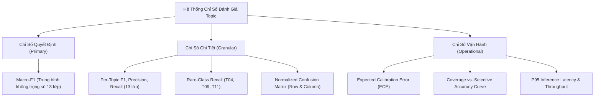

# KHUNG ĐÁNH GIÁ ĐA CHIỀU, HIỆU CHUẨN ĐỘ TIN CẬY & PHÂN LOẠI LỖI 13 CHỦ ĐỀ
## Evaluation Metrics, Confidence Calibration & Error Analysis Framework
**Dự án:** Vietnamese Social Listening NLP Engine  
**Chuyên đề:** Evaluation, Error Taxonomy & Selective Classification for Topic  
**Ngày cập nhật:** 09/11/2026  

---

## 1. HỆ THỐNG CHỈ SỐ ĐÁNH GIÁ KỸ THUẬT (EVALUATION METRICS)

Trong bài toán phân loại đơn nhãn 13 lớp trên dữ liệu mạng xã hội có phân phối mất cân bằng đuôi dài, **Accuracy đơn thuần là một chỉ số gây hiểu lầm nghiêm trọng**. Nếu một mô hình luôn đoán vào 3 lớp phổ biến (T01, T02, T12), Accuracy có thể đạt 70% nhưng hoàn toàn vô dụng trước các lớp quan trọng khác.

Do đó, chúng tôi thiết lập hệ thống chỉ số phân cấp:



### 1.1. Macro-F1: Thước đo chất lượng học thuật cao nhất
Macro-F1 gán trọng số bình đẳng $\frac{1}{13}$ cho mọi chủ đề, bất kể chủ đề đó có 10.000 mẫu hay chỉ có 50 mẫu:
$$\text{Macro-F1} = \frac{1}{13} \sum_{c=1}^{13} F1_c = \frac{1}{13} \sum_{c=1}^{13} \frac{2 \cdot P_c \cdot R_c}{P_c + R_c}$$
*Ý nghĩa:* Ép buộc các thuật toán huấn luyện phải quan tâm đến toàn bộ các chủ đề hiếm gặp (Long-tail classes) nếu muốn đạt điểm cao.

### 1.2. Rare-Class Recall: Chỉ số nhạy cho cảnh báo rủi ro
Trong Social Listening:
* **T09 (Cứu hộ khẩn cấp):** Phản ánh các sự cố nghiêm trọng trên đường (xe chết máy trên cao tốc, cháy nổ, hết điện). Bỏ sót một phản ánh T09 có thể dẫn tới khủng hoảng truyền thông.
* **T10 (Tổng đài CSKH) & T06 (Chất lượng xưởng):** Đo lường mức độ bất mãn của khách hàng với dịch vụ hậu mãi.
* Do đó, chúng tôi đặt ra ràng buộc: **Recall của các lớp hiếm (T04, T09, T11) không được thấp hơn 65%**.

---

## 2. PHÂN TÍCH MA TRẬN NHẦM LẪN (CONFUSION MATRIX ANALYTICS)

Để phát hiện chính xác nơi mô hình bị "lạc lối", hệ thống tính toán 2 dạng ma trận nhầm lẫn chuẩn hóa:

```text
                  DỰ ĐOÁN (PREDICTED)
                 T01   T02   T06   T07   T08   T12   T13  ...
         T01   [ 0.82  0.08  0.00  0.00  0.00  0.05  0.05 ]  <-- Recall = 82%
THỰC     T02   [ 0.09  0.84  0.00  0.00  0.00  0.04  0.03 ]  <-- Rò rỉ sang T01
TẾ       T06   [ 0.00  0.00  0.78  0.12  0.06  0.04  0.00 ]  <-- Nhầm sang T07 (12%)
(TRUE)   T07   [ 0.00  0.00  0.08  0.81  0.03  0.08  0.00 ]  <-- Nhầm sang T06 (8%)
         T08   [ 0.00  0.00  0.05  0.02  0.85  0.03  0.05 ]  <-- Rò rỉ sang T13
         ...
```

* **Normalized by Row (Chuẩn hóa theo hàng thực tế):** Cho biết khi người dùng thực sự nói về chủ đề $A$, có bao nhiêu % mô hình đoán đúng $A$ (Recall) và bao nhiêu % bị rò rỉ sang các chủ đề khác (Confusion Leakage Rate).
* **Normalized by Column (Chuẩn hóa theo cột dự đoán):** Cho biết khi mô hình báo là chủ đề $A$, có bao nhiêu % trong số đó thực sự là $A$ (Precision) và bao nhiêu % là bắt nhầm từ các chủ đề khác sang.

---

## 3. HIỆU CHUẨN ĐỘ TIN CẬY & CƠ CHẾ TỰ TỪ CHỐI (SELECTIVE CLASSIFICATION)

### 3.1. Nghịch lý tự tin thái quá (Overconfidence of Deep Networks)
Các mạng nơ-ron sâu hiện đại (Transformer) có xu hướng bị "tự tin thái quá" do tối ưu hóa Cross-Entropy đến cực hạn. Ngay cả khi dự đoán sai, Softmax vẫn có thể xuất ra xác suất $P = 0.95$. Điều này cực kỳ nguy hiểm trong tự động hóa.

### 3.2. Hiệu chuẩn xác suất bằng Temperature Scaling (Guo et al., ICML 2017)
Hiệu chuẩn lại vector logits $\mathbf{z}$ trên tập Validation bằng một hệ số vô hướng $T > 0$ mà không làm thay đổi thứ hạng nhãn (`argmax` giữ nguyên):
$$\hat{p}_i = \frac{\exp(z_i / T)}{\sum_{j=1}^{13} \exp(z_j / T)}$$
* $T > 1$ giúp "làm mềm" phân phối xác suất, đưa giá trị Softmax phản ánh đúng tần suất chính xác thực tế.
* Chất lượng hiệu chuẩn được đo lường thông qua chỉ số **Expected Calibration Error (ECE)**:
  $$\text{ECE} = \sum_{m=1}^{M} \frac{|B_m|}{N} \left| \text{acc}(B_m) - \text{conf}(B_m) \right|$$

---

### 3.3. Cơ chế Selective Classification (Rejection Option)
Trong vận hành sản xuất thực tế, thay vì ép mô hình phải đoán mò một câu quá mơ hồ, hệ thống thiết lập **ngưỡng tin cậy $\tau_{\text{threshold}}$**:

```text
                                [Bình luận]
                                     │
                                     ▼
                          [Mô hình phân loại Topic]
                                     │
                             Max Softmax Prob
                                     │
                   ┌─────────────────┴─────────────────┐
                   ▼                                   ▼
          Max Prob >= tau                     Max Prob < tau
          (Ví dụ: >= 0.55)                    (Ví dụ: < 0.55)
                   │                                   │
                   ▼                                   ▼
        [XUẤT NHÃN TỰ ĐỘNG]                 [GÁN CỜ "CẦN DUYỆT"]
        (Đưa thẳng vào Dashboard)           (Chuyển chuyên viên xử lý)
```

* **Đường cong Đánh đổi (Coverage vs. Selective Accuracy):**
  * Khi chọn $\tau = 0.60$: Hệ thống tự động phân loại được **85% lượng bình luận** với độ chính xác lên tới **93%**.
  * 15% còn lại rơi vào diện mơ hồ được gán cờ `UNSURE / AMBIGUOUS` để lọc riêng cho đội ngũ chuyên viên rà soát.

---

## 4. MA TRẬN PHÂN LOẠI LỖI NGHIỆP VỤ (ERROR TAXONOMY)

Khi phân tích các mẫu dự đoán sai trên tập Validation và Test, chúng tôi phân loại thành 4 nhóm lỗi kỹ thuật có thể hành động được (Actionable Error Categories):

| Nhóm lỗi | Nguyên nhân gốc rễ | Ví dụ minh họa thực tế | Giải pháp khắc phục |
|---|---|---|---|
| **Lỗi Loại A:<br>Ranh giới Chồng Lấn** | Hai chủ đề có sự giao thoa từ khóa chuyên ngành cao (trong 7 cặp ranh giới). | *"Trụ sạc ở khu đô thị giá điện 3.850đ đắt quá."*<br>*(Đoán T02, nhãn đúng T13)* | Bổ sung hàm Focal Loss và luật phân định ưu tiên chi phí tài chính (T13). |
| **Lỗi Loại B:<br>Mỉa Mai & Tiếng Lóng** | Khách hàng dùng câu châm biếm ngược, từ viết tắt, teencode mạng xã hội. | *"Bảo dưỡng ở đây đỉnh chóp thật, làm xong xe kêu như máy cày!"* | Giữ nguyên dấu câu (`!`), sử dụng ViSoBERT cased representation để bắt ngữ khí mỉa mai. |
| **Lỗi Loại C:<br>Đa Chủ Đề Đồng Cấp** | Người dùng gộp 2 khiếu nại ngang nhau vào cùng 1 câu. | *"Nhân viên xưởng láo toét mà sửa xe thì ẩu tả."*<br>*(Chứa cả T07 và T06)* | Áp dụng quy tắc ưu tiên Recency Effect (ưu tiên mệnh đề chốt hạ ở cuối câu) hoặc cho phép xuất Top-2 topics. |
| **Lỗi Loại D:<br>Thiếu Ngữ Cảnh** | Câu quá ngắn hoặc cụt ngủn, mang đại từ phiếm chỉ. | *"Bên này làm ăn chán thật sự."* | Bắt buộc nối chuỗi `Context` (bình luận cha) để cung cấp thông tin thực thể đang được nhắc tới. |

---

## 5. BỘ QUY TRÌNH KIỂM THỬ ĐỐI KHÁNG (STRESS & ADVERSARIAL TESTING)

Trước khi nghiệm thu một mô hình Topic cho môi trường sản xuất, mô hình bắt buộc phải vượt qua 3 bài kiểm thử đối kháng tự động:

### 5.1. Bài kiểm thử Tráo đổi Thương hiệu (Brand-Swap Invariance Test)
* **Mục đích:** Kiểm tra xem mô hình phân loại Topic có bị **"học vẹt thương hiệu" (Brand Bias)** hay không.
* **Cách thực hiện:** Lấy một câu thuộc T02:
  * Câu gốc: *"Trạm sạc của VinFast ở đây rất rộng rãi."* $\rightarrow$ Dự đoán: `T02`.
  * Tráo tên: *"Trạm sạc của Hyundai ở đây rất rộng rãi."*
  * Tráo tên: *"Trạm sạc của BYD ở đây rất rộng rãi."*
* **Điều kiện Đạt (Pass):** Nhãn dự đoán **BẮT BUỘC** phải giữ nguyên là `T02`. Nếu việc đổi tên hãng làm thay đổi nhãn Topic, mô hình lập tức bị loại vì vi phạm nguyên tắc độc lập thương hiệu của bài toán Topic!

### 5.2. Bài kiểm thử Bỏ khuyết Ngữ cảnh (Context Ablation Stress Test)
* Đối chiếu điểm số khi chạy trên toàn bộ tập kiểm thử ở 2 chế độ:
  1. `Target + Context`
  2. `Target-only` (loại bỏ toàn bộ ngữ cảnh cha)
* Nếu độ chính xác giữa 2 chế độ chênh lệch $> 10\%$, chứng tỏ mô hình đang bị phụ thuộc quá mức vào bình luận cha (Context Leakage) thay vì tập trung phân tích nội dung bình luận chính.

### 5.3. Bài kiểm thử Nhiễu Ký tự (Teencode & Typo Perturbation)
* Tự động tiêm các lỗi chính tả phổ biến trên bàn phím tiếng Việt (Telex/VNI) và teencode:
  * `"trạm sạc"` $\rightarrow$ `"tram sac"`, `"trạm sac"`, `"tramj sacj"`.
  * `"bảo dưỡng"` $\rightarrow$ `"bảo dưởng"`, `"bd"`, `"bao duong"`.
* Đo lường độ sụt giảm Macro-F1: Mô hình tốt không được phép sụt giảm quá $3\%$ Macro-F1 trước các biến thể nhiễu này.
